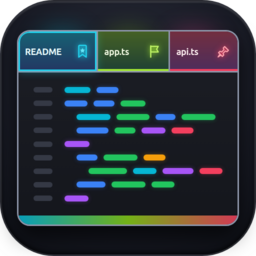
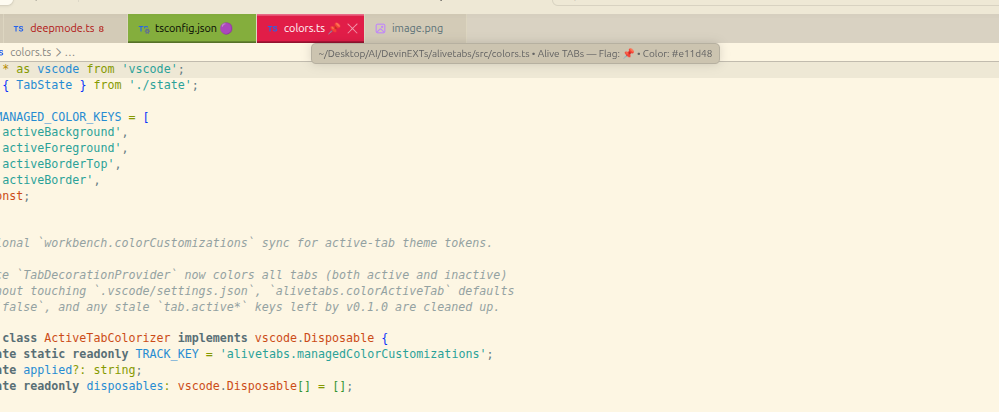
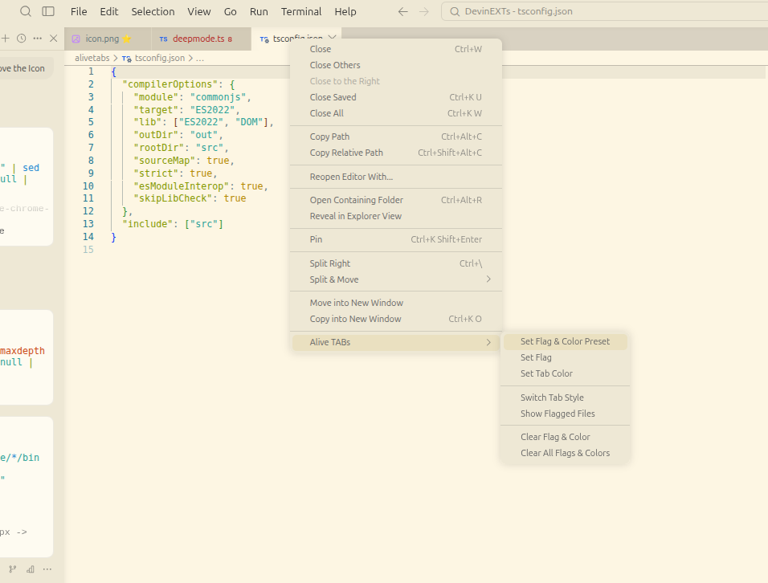
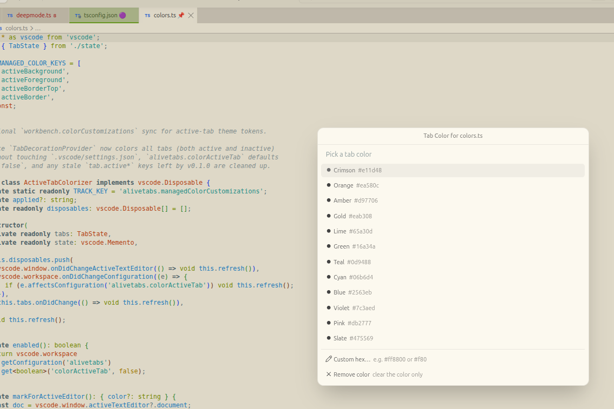
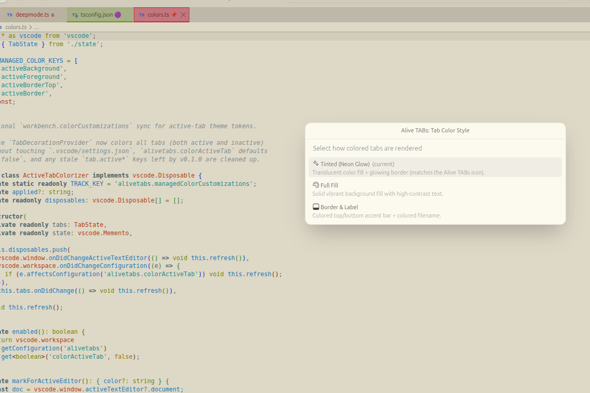
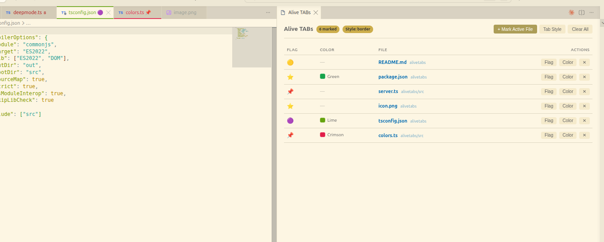

#  Alive TABs

Color your editor tabs and mark files or agent sessions with colored flags in **Devin Desktop**, **Windsurf**, **VS Code**, **Cursor**, and **VSCodium**.

<p align="center">
  <a href="https://buymeacoffee.com/himanshuv" target="_blank"></a><br/>
  <em>Enjoying Alive TABs? Fuel its development ☕</em>
</p>



## Features

- **Per-Tab Coloring on All Tabs (No Root Patch Required)** — Every marked tab (files, Claude Code webview tabs, Devin/Cascade agent tabs, and untitled editors) keeps its own color simultaneously across both active and inactive tabs AND in the Explorer tree, without modifying `.vscode/settings.json` or needing `sudo`.
- **Three Tab Color Styles** (`alivetabs.tabStyle`):
  - `tinted` *(default)* — Neon-pill translucent tint + glowing border matching the Alive TABs icon.
  - `full` — Solid vibrant background fill with automatic high-contrast text.
  - `border` — Minimalist colored top/bottom accent bar + colored filename.
- **Colored Flags & Custom Tags** — Tag tabs with 🔴 🟠 🟡 🟢 🔵 🟣 🚩 ⭐ 📌 🔥 ⚡ 🧪 or any custom emoji/short text (e.g. `WIP`, `TODO`, `BUG`). Flags appear on the tab label (prefix or suffix) and as a badge in the Explorer sidebar.
- **One-Click Presets + Custom Presets** — *Set Flag & Color Preset* applies a matching flag + tab color in one step (*Urgent / Bug*, *In Progress*, *Needs Review*, *Done*, *Reference*, *Core*, *Flagged*, *Starred*, *Pinned*), and `alivetabs.presets` lets you add your own.
- **Auto-Flag Rules** — `alivetabs.rules` automatically flags/colors files by glob (e.g. `**/*.test.*` → 🧪) — no marking required; rule-matched open files appear as `auto` rows in the overview.
- **Rename & Delete Aware** — Moving or renaming a file or parent folder automatically migrates its flag and tab color.
- **Status Bar Indicator & Overview Panel** — Shows the active tab's mark and total marked tab count in the status bar; click to open the interactive Overview panel.
- **Session Tabs Survive Restarts** — Flags on Claude/agent webview tabs re-attach automatically after IDE restarts (labels + view-type reconciliation).

---

## Screenshots

### 1. Right-Click `Alive TABs` Submenu
Right-click any editor tab (including Claude Code and Agent tabs) or Explorer file to access all Alive TABs actions from a single nested menu:



### 2. Curated Color Palette & Custom Hex Colors
Choose from 12 vibrant palette colors or enter any 3- or 6-digit `#hex` color:



### 3. Switch Between 3 Tab Color Styles (`Tinted`, `Full Fill`, `Border & Label`)
Switch styles on the fly with `Alive TABs: Switch Tab Style`:



### 4. Interactive Overview Panel (`Show Flagged Files`)
Manage all flagged and colored tabs across your workspace in one place, with inline **Flag**, **Color**, and **Clear** buttons:



---

## Commands

| Command | What it does |
|---|---|
| `Alive TABs: Set Flag & Color Preset` | Apply a coordinated flag + tab color preset in one click |
| `Alive TABs: Set Flag` | Add, change, or remove a flag emoji / custom tag on a tab |
| `Alive TABs: Set Tab Color` | Assign a palette or custom `#hex` color to a tab |
| `Alive TABs: Switch Tab Style` | Switch between `tinted`, `full`, and `border` tab styles |
| `Alive TABs: Show Flagged Files` | Open the interactive Alive TABs overview panel |
| `Alive TABs: Clear Flag & Color` | Remove both flag and color from a tab |
| `Alive TABs: Clear All Flags & Colors` | Reset all marks in the workspace |
| `Alive TABs: Enable/Disable Deep Mode` | Optional workbench.html runtime patch fallback |

## Settings

| Setting | Default | Description |
|---|---|---|
| `alivetabs.tabStyle` | `"tinted"` | Visual style for colored tabs: `"tinted"`, `"full"`, or `"border"`. |
| `alivetabs.flagPosition` | `"suffix"` | Place the flag after (`"suffix"`) or before (`"prefix"`) the tab name. |
| `alivetabs.showStatusBarItem` | `true` | Show the Alive TABs indicator in the status bar. |
| `alivetabs.useCustomLabels` | `false` | Also sync flag patterns to `workbench.editor.customLabels.patterns` in `.vscode/settings.json`. |
| `alivetabs.colorActiveTab` | `false` | Also sync `tab.activeBackground` to `workbench.colorCustomizations` in `.vscode/settings.json`. |
| `alivetabs.rules` | `[]` | Auto-apply flags/colors to files matching globs — e.g. `[{ "pattern": "**/*.test.*", "flag": "🧪" }]`. Patterns with `/` match the workspace-relative path, without `/` match the basename. Stored marks take precedence. |
| `alivetabs.presets` | `[]` | Extra entries in the *Set Flag & Color Preset* picker — e.g. `[{ "name": "Design", "flag": "🎨", "color": "#0ea5e9" }]`. |

## Installation

### From Marketplace (Devin Desktop / Windsurf / Cursor / VSCodium)

Search for **`Alive TABs`** (or **`WebieAPP.alivetabs`**) in the Extensions sidebar (`Ctrl+Shift+X`), or visit **[Open VSX — WebieAPP.alivetabs](https://open-vsx.org/extension/WebieAPP/alivetabs)**.

```bash
# Install directly by extension ID
/usr/share/devin-desktop/bin/devin-desktop --install-extension WebieAPP.alivetabs
```

### From VSIX ([GitHub Releases](https://github.com/himanverma/alive-tabs/releases))

1. Download the latest `alivetabs-0.3.4.vsix` from [Releases](https://github.com/himanverma/alive-tabs/releases) (or the repository root).
2. In **Devin Desktop / Windsurf / VS Code / Cursor**: open **Extensions** (`Ctrl+Shift+X`) → **`⋯` menu** → **Install from VSIX…** and select `alivetabs-0.3.4.vsix`.

Or install from the terminal:

```bash
# Devin Desktop
/usr/share/devin-desktop/bin/devin-desktop --install-extension alivetabs-0.3.4.vsix --extensions-dir ~/.devin/extensions --force

# VS Code / Windsurf / Cursor
code --install-extension alivetabs-0.3.4.vsix
```

## Publishing

Releases are published to the **Open VSX Registry** and **GitHub Releases** (VSIX attached); the VS Code Marketplace listing is updated manually by the maintainer.

## Show Some Support

If Alive TABs helps your workflow, show some support:

<p align="center">
  <a href="https://buymeacoffee.com/himanshuv" target="_blank"></a>
</p>

- ☕ **[Buy me a coffee](https://buymeacoffee.com/himanshuv)** — keeps the releases coming
- ⭐ Star this repo on [GitHub](https://github.com/himanverma/alive-tabs)
- 💛 Check out the author — [himanverma.github.io/github-resume](https://himanverma.github.io/github-resume/)
- 🐛 Found a bug or have an idea? [Open an issue](https://github.com/himanverma/alive-tabs/issues)
